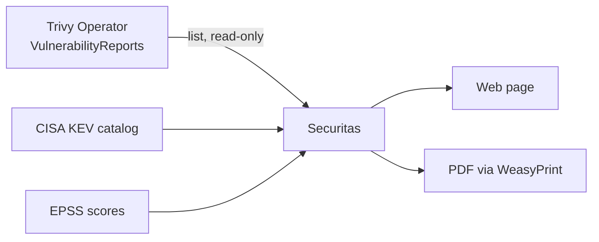

# Securitas

A read-only CVE report for Kubernetes clusters. Securitas reads the vulnerability reports that
[Trivy Operator](https://aquasecurity.github.io/trivy-operator/) keeps in your cluster, ranks the
findings with the [CISA Known Exploited Vulnerabilities](https://www.cisa.gov/known-exploited-vulnerabilities-catalog)
(KEV) catalog and [EPSS](https://www.first.org/epss/) scores, and serves the result as one web page.
An **Export to PDF** button at the top downloads the same report for printing.

- **Ranked, not just counted.** A CVE is a *priority* when it is in the KEV catalog (seen exploited
  in the wild) or its EPSS score is at or above a threshold (default 0.10). Known-exploited CVEs are
  listed first, then by EPSS.
- **Two tables per platform:** the affected images, and the priority CVEs with severity, KEV date,
  ransomware use, EPSS, affected images, packages and the fixed version.
- **Read-only.** Securitas only lists VulnerabilityReports. The web server answers GET and HEAD,
  the page has no scripts, and the container runs as non-root with a read-only filesystem.
- **PDF without a browser.** PDFs are made with [WeasyPrint](https://weasyprint.org/) from the same
  HTML, so the page and the printout match.
- **Refreshes on its own** (hourly by default). Feeds are cached; if a download fails, the last good
  copy is used and the report says so.

## Install

Requirements: Kubernetes 1.25 or later, Helm 3, and Trivy Operator already installed and scanning.

```bash
helm repo add securitas https://uhlix-net.github.io/securitas
helm install securitas securitas/securitas -n securitas --create-namespace
kubectl -n securitas port-forward svc/securitas 8080:80
# open http://127.0.0.1:8080/
```

The first report is ready a minute or two after the pod starts. Each release's chart is also
attached to its [GitHub release](https://github.com/uhlix-net/securitas/releases).

> **Security notice.** The report lists unpatched software in your cluster and has no login of its
> own. Expose it only on a trusted network or behind an authenticating proxy (for example
> oauth2-proxy, or your ingress controller's forward-auth).

## Configuration

| Value | Default | Description |
|---|---|---|
| `config.title` | `Securitas` | Page and PDF title |
| `config.clusterName` | `""` | Shown in the heading, e.g. `prod-eu` |
| `config.refreshSeconds` | `3600` | How often the report is rebuilt (minimum 60) |
| `config.epssMin` | `0.10` | EPSS score at which a CVE becomes a priority |
| `config.namespaces` | `[]` | Namespaces to report on. Empty = all; when set, read access is granted in those namespaces only |
| `config.paper` | `letter` | PDF page size: `letter` or `A4` (always landscape) |
| `config.kevUrl` / `config.epssUrl` | CISA / FIRST feeds | Point at internal mirrors for air-gapped clusters |
| `extraEnv` | `[]` | Extra environment, e.g. `HTTPS_PROXY` and `NO_PROXY` for the feed downloads |
| `extraPlatforms.configMap` | `""` | ConfigMap with extra platform JSON files (see below) |
| `ingress.*` | disabled | Standard Ingress settings |
| `resources` | 50m / 128Mi request, 512Mi limit | PDF generation of large reports needs the memory |

Outbound access needed: the Kubernetes API, and HTTPS to `www.cisa.gov` and `epss.empiricalsecurity.com`
(or your mirrors). The page links CVEs to `nvd.nist.gov`.

The report data is also served as JSON at `/data.json`.

## Extra platforms (optional)

Hosts scanned by other tools can be added as extra sections. Put one JSON file per platform in a
ConfigMap and set `extraPlatforms.configMap`. Securitas adds the KEV and EPSS data and lists only
priority CVEs.

```json
{
  "id": "linux",
  "title": "Linux",
  "subtitle": "Servers: installed packages compared with vendor advisories",
  "totals": {"Servers scanned": 2},
  "systems_caption": "Servers",
  "system_columns": [
    {"key": "name", "label": "Server", "type": "mono"},
    {"key": "pending", "label": "Pending updates", "type": "num"}
  ],
  "systems": [{"name": "web01", "pending": 12}, {"name": "db01", "pending": 3}],
  "affected_label": "Servers",
  "cves": [
    {"cve": "CVE-2025-0001", "title": "Example flaw", "severity": "Important",
     "systems": ["web01"], "component": "openssl", "fix": "Pending OS update", "status": "Open"}
  ]
}
```

Column `type` is `text`, `mono`, `num`, `hot` (number, red when non-zero) or `date`.

## How it works



## Development

```bash
python3 -m unittest discover -s tests          # PDF test is skipped unless WeasyPrint is installed
docker build -t securitas:dev .
kubectl proxy --port=8001 &
docker run --rm --network host -e SECURITAS_API_URL=http://127.0.0.1:8001 -e SECURITAS_DATA_DIR=/tmp securitas:dev
```

Set `SECURITAS_REPORTS_FILE` to the output of `kubectl get vulnerabilityreports -A -o json` to run
without a cluster.

## Releases

Pushing a tag `vX.Y.Z` builds `docker.io/uhlix/securitas:X.Y.Z` (amd64 and arm64), attaches the
chart to the GitHub release and updates the Helm repository on GitHub Pages.

## License

Apache License 2.0. See [LICENSE](LICENSE).

Securitas is not affiliated with CISA, FIRST, Aqua Security or the WeasyPrint project.
