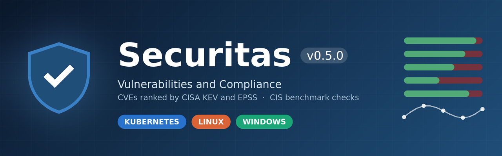
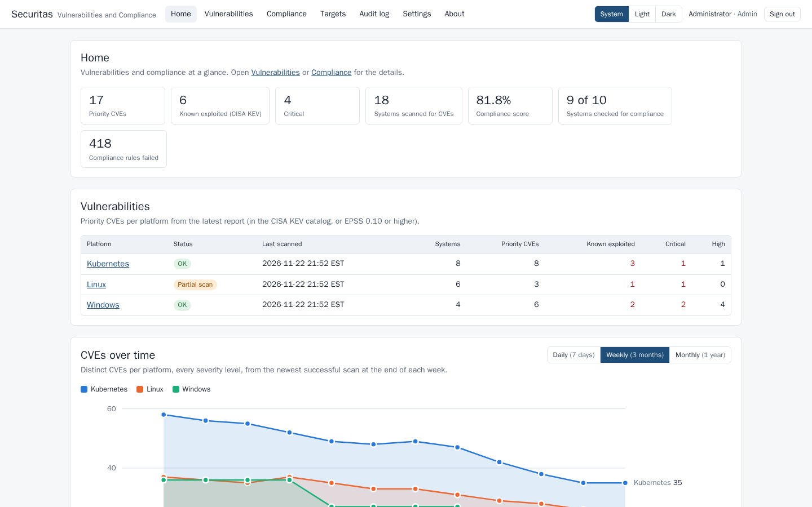
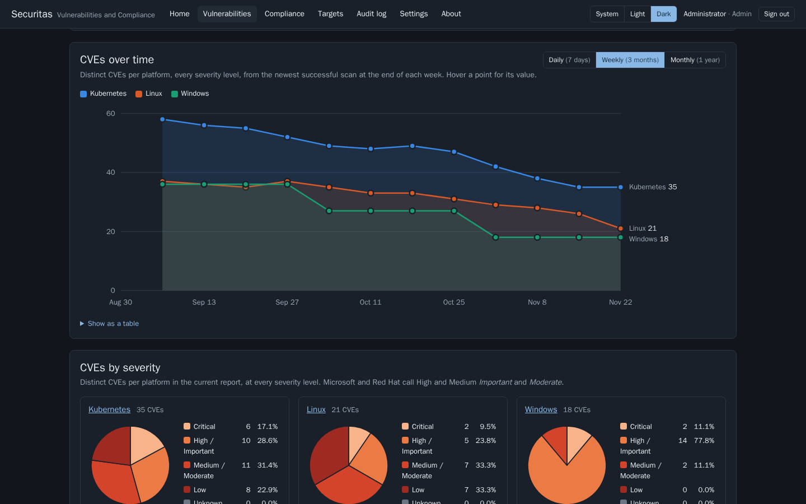
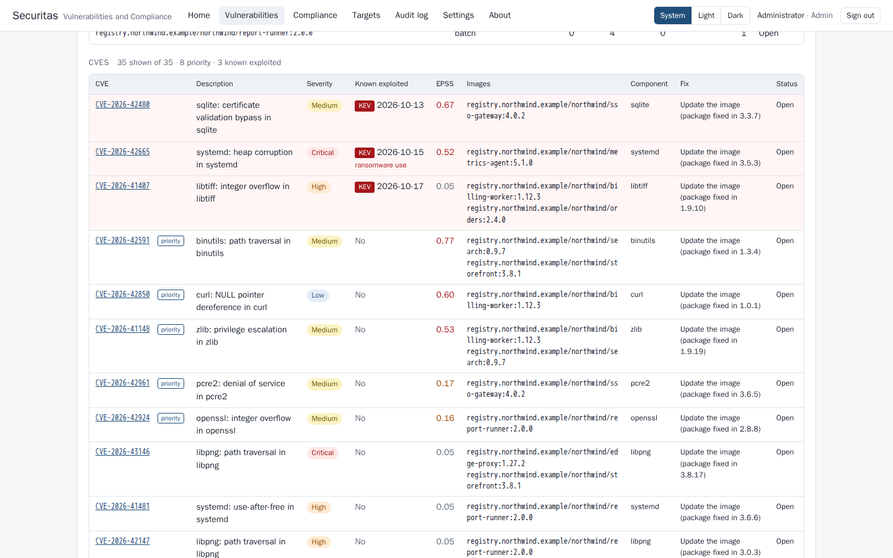
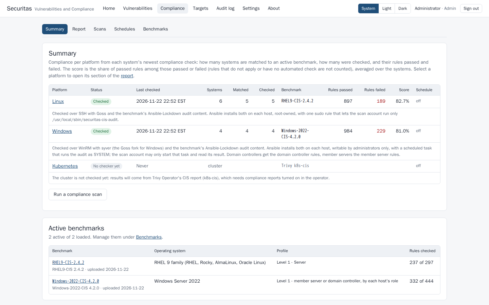
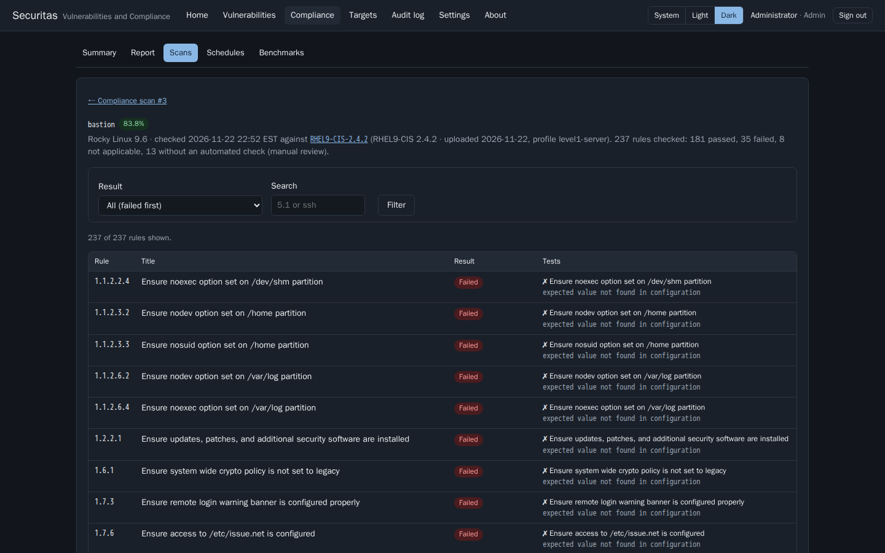
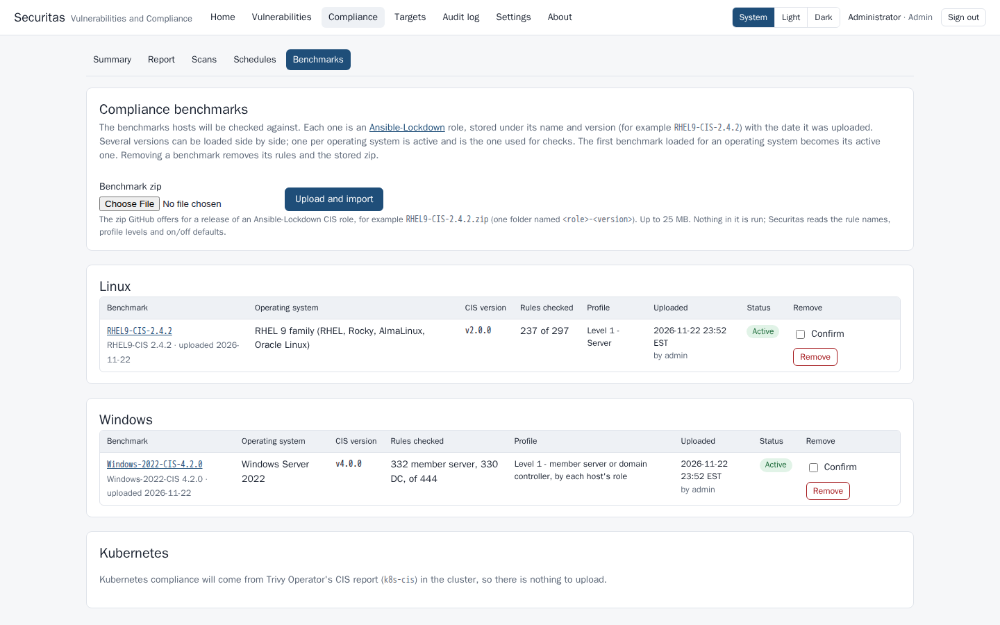
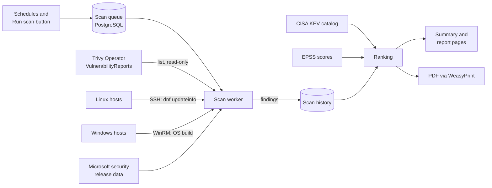

<p align="center">
  
</p>

# Securitas

Vulnerability and compliance reports for Kubernetes, Linux and Windows. Securitas scans on a schedule or on demand, ranks
the findings with the [CISA Known Exploited Vulnerabilities](https://www.cisa.gov/known-exploited-vulnerabilities-catalog)
(KEV) catalog and [EPSS](https://www.first.org/epss/) scores, keeps every scan in its history, and
serves the results as web pages with an **Export to PDF** button.

- **Three platforms.**
  - **Kubernetes:** reads the vulnerability reports that [Trivy Operator](https://aquasecurity.github.io/trivy-operator/) keeps in the cluster.
  - **Linux (RHEL family):** connects over SSH and lists pending security advisories with `dnf updateinfo`.
  - **Windows:** connects over WinRM, reads the OS build and compares it with Microsoft's monthly security release data.
- **Scans change nothing.** Nothing is installed or changed on the scanned systems, and the scan
  accounts need no root or admin rights.
- **Ranked, not just counted.** A CVE is a *priority* when it is in the KEV catalog (seen exploited
  in the wild) or its EPSS score is at or above a threshold (default 0.10). The report lists every CVE at
  every severity level, priority CVEs first (known-exploited at the top, then by EPSS). The current report is
  re-ranked when the KEV catalog changes, without a rescan.
- **Severity filter.** The report, past scans and the PDF can be narrowed to one or more severity levels
  (Critical, High / Important, Medium / Moderate, Low, Unknown) and to priority CVEs only. The filter is in
  the address, so a filtered view can be bookmarked or shared; Export to PDF uses the same filter.
- **Vulnerability summary.** *Vulnerabilities → Summary* lists each platform with its scan status, when it was
  last scanned, and its counts: systems, priority CVEs, known exploited, critical and high. Each platform
  name links to its section of the full report at `/report`. The same table opens the report and the PDF.
  Below it, a graph of distinct CVEs per platform over time (daily for 7 days, weekly for 3 months or
  monthly for a year; daily by default) and a pie chart per platform of its CVEs by severity.
- **Failed scans are flagged, not hidden.** If a platform's latest scan failed or was only partly
  successful, the summary, the report and the PDF say so and show the error. Older results stay
  visible but are marked as older; a platform that has never been scanned successfully still gets a section saying so.
- **Scheduled and on-demand scans, with history.** Each platform has its own cron schedule.
  Operators can start a scan at any time. Every past scan can be opened and exported as it was at the time,
  and the history can be filtered by platform.
- **Settings in the browser.** Admins configure LDAP, single sign-on, the scan accounts (SSH key,
  WinRM password), targets, schedules, users and vulnerability sources on the Settings pages. Changes
  apply immediately; secrets are encrypted in the database and never shown again. Anything not set
  there comes from the Helm values, so a plain Helm install still works unchanged.
- **Home page and two sections.** *Home* sums up vulnerabilities and compliance with charts. The top menu then
  has *Vulnerabilities* (summary, report, scans, schedules, sources) and *Compliance* (summary, report, scans,
  schedules, benchmarks), then *Targets*, *Audit log*, *Settings* and *About*.
- **Transparent sources.** The Sources page (Vulnerabilities → Sources) explains every data source (CISA KEV, EPSS, Trivy, dnf
  advisories, Microsoft release data), when it was last fetched, what turning it off changes, and shows
  the exact script each scanner runs on a host. KEV and EPSS can be turned off; each platform can be
  turned off.
- **Compliance benchmark library.** Admins upload [Ansible-Lockdown](https://github.com/ansible-lockdown)
  CIS roles (the release zip, for example `RHEL9-CIS-2.4.2.zip`) on Compliance → Benchmarks. Each upload is stored
  under its role name and version with the upload date, the uploader and the file's SHA-256, and its rules
  are read from the role: rule ID, title, profile levels, NIST 800-53 mappings and the role's on/off default.
  Several versions can be loaded side by side; one per operating system is active. Pick a profile (Level 1
  Server by default), switch single rules on or off, download the original zip, or remove a benchmark.
  Nothing in an uploaded zip is run.
- **Linux compliance checks.** Compliance scans check each Linux host against its active benchmark with Goss and
  the benchmark's Ansible-Lockdown audit content, through one root-owned wrapper the scan account may run with
  sudo (nothing else). Per host: rules passed, failed, not applicable and without an automated check, a score,
  and every rule's tests.
- **Windows compliance checks.** The same for Windows Server, with syver (the Goss fork for Windows) and the
  benchmark's audit content, run as SYSTEM by a scheduled task the scan account may only start. Domain
  controllers get the domain controller rules, member servers the member server rules. Kubernetes compliance
  comes later.
- **Sign-in and roles.**
  - Sign-in: local accounts, LDAP (Active Directory) and OpenID Connect single sign-on.
  - Three roles: Viewer, Operator and Admin. LDAP and SSO users get their role from their groups.
  - Every sign-in and change goes to an audit log.
- **Light and dark mode.** Each user picks System, Light or Dark at the top of every page.
- **No scripts in the pages.** The Content Security Policy blocks all scripts and every form
  carries a CSRF token. The container runs as non-root with a read-only filesystem.

What's new in each version: [CHANGELOG.md](CHANGELOG.md). Upgrading? See the upgrade notes there.

## Screenshots

| | |
|---|---|
|  |  |
| Home | CVEs over time and by severity (dark mode) |
|  |  |
| Vulnerability report, ranked by KEV and EPSS | Compliance summary |
|  |  |
| Per-host CIS rule results (dark mode) | Benchmark library |

The screenshots use made-up demo data (fictional hosts, images and CVE numbers; compliance results against the real
RHEL 9 and Windows Server 2022 CIS benchmarks, with random pass/fail).

## Roles

| Permission | Viewer | Operator | Admin |
|---|---|---|---|
| View the summary, report and scan history, export PDF | Yes | Yes | Yes |
| Run scans now | | Yes | Yes |
| Change schedules | | Yes | Yes |
| See the Sources page (data sources and how each platform is scanned) | Yes | Yes | Yes |
| Browse compliance benchmarks and their rules | Yes | Yes | Yes |
| Upload, activate, configure, download and remove compliance benchmarks | | | Yes |
| Change scan targets | | | Yes |
| Scan credentials (SSH key, WinRM account) and connection tests | | | Yes |
| Turn sources on or off, EPSS threshold | | | Yes |
| Manage users | | | Yes |
| Authentication settings (LDAP, single sign-on) and group-to-role mappings | | | Yes |
| Audit log | | | Yes |

Users, authentication and scan credentials are under **Settings**; **Targets** and **Audit log** have their own
menus; schedules and sources are under **Vulnerabilities**, and compliance schedules and the benchmark library
under **Compliance**. Each user sees only the pages their role allows.

## Install

Requirements: Kubernetes 1.25 or later and Helm 3. Trivy Operator must be installed for the Kubernetes report.

```bash
helm repo add securitas https://uhlix-net.github.io/securitas
helm install securitas securitas/securitas -n securitas --create-namespace \
  --set web.baseUrl=https://securitas.example.com --set ingress.enabled=true \
  --set 'ingress.hosts[0].host=securitas.example.com' --set 'ingress.hosts[0].paths[0].path=/' \
  --set 'ingress.hosts[0].paths[0].pathType=Prefix'
kubectl -n securitas get secret securitas-admin -o jsonpath='{.data.password}' | base64 -d; echo
```

Sign in as `admin` with that password. The chart creates the admin password, and the bundled
PostgreSQL password, in Secrets that keep their values across upgrades. Session cookies are
HTTPS-only: for a plain-HTTP trial with `kubectl port-forward`, set `web.secureCookies=false`.

## Configuration

Two places, with one rule: **a value saved on a Settings page wins; anything not saved there comes from
the Helm values.** Each field on those pages shows where its current value comes from, and can be put back
to the deployment's value. LDAP, single sign-on, the Linux and Windows scan accounts, sources and the EPSS
threshold can be set either way. Secrets saved in the browser are encrypted with a key the chart generates
(`settings.secretKey`; keep it with your database backups: without it those secrets cannot be read).

The full list of Helm values with comments is in [`charts/securitas/values.yaml`](charts/securitas/values.yaml).
The main groups:

| Values | What they set |
|---|---|
| `config.*` | Title, cluster name, EPSS threshold, Trivy namespaces, PDF paper size, time zone, history retention, feed URLs |
| `web.*` | Public URL (needed for SSO), cookie security, session length, trusted proxies |
| `auth.admin` | The local break-glass admin (password from a Secret) |
| `auth.roleMappings` | Group to role pairs, seeded once and edited in the UI afterwards |
| `auth.ldap.*` | LDAP URL, bind DN and password Secret, user base and filter, group base for nested groups |
| `auth.oidc.*` | Issuer, client ID, client secret Secret, scopes, user name and groups claims, button label |
| `caBundle.*` | ConfigMap with extra CA certificates for LDAPS, the SSO provider and WinRM over HTTPS |
| `scanning.schedules` | Cron per platform, seeded once and edited on the Schedules page afterwards |
| `scanning.linux.*` | SSH user, key Secret, optional known_hosts ConfigMap, optional repository override |
| `scanning.windows.*` | WinRM user, password Secret, port, HTTPS, authentication method |
| `database.*` | Bundled PostgreSQL (StatefulSet with a PersistentVolume) or an external server |
| `settings.secretKey.*` | The key that encrypts secrets saved in the browser (generated if not given) |

Outbound access needed:
- The Kubernetes API.
- HTTPS to `www.cisa.gov`, `epss.empiricalsecurity.com` and `api.msrc.microsoft.com` (or your mirrors).
- SSH (22) to Linux targets and WinRM (5986) to Windows targets.
- Your LDAP server and SSO provider.

### Single sign-on

Register a confidential OpenID Connect client with the redirect URI
`<web.baseUrl>/auth/oidc/callback`, and make the provider send a `groups` claim. Then either fill in
**Settings > Authentication > Single sign-on** (and press *Test the provider*), or use Helm values:

```bash
kubectl -n securitas create secret generic securitas-oidc --from-literal=client-secret=...
helm upgrade securitas securitas/securitas -n securitas --reuse-values \
  --set auth.oidc.enabled=true --set auth.oidc.issuer=https://idp.example.com/application/o/securitas/ \
  --set auth.oidc.clientId=... --set auth.oidc.clientSecretSecret.name=securitas-oidc \
  --set auth.roleMappings.Securitas-Admins=admin --set auth.roleMappings.Securitas-Viewers=viewer
```

The sign-in uses the authorization code flow with PKCE, state and nonce, and the ID token signature
is checked against the provider's keys. A user with no mapped group cannot sign in unless an admin
gives them a fixed role. An SSO or LDAP sign-in never takes over a local account with the same name.

### LDAP / Active Directory

Users are looked up with a service account and then verified by binding as the user. Groups come
from `memberOf`. With `groupBase` set, nested groups are found with the Active Directory
in-chain matching rule. Configure it in **Settings > Authentication > LDAP** or with `auth.ldap.*`. On the
same page, admins can look a user up to see their DN, groups and the resulting role.

### Preparing targets

[docs/target-setup.md](docs/target-setup.md) walks through preparing Linux and Windows hosts: the scan accounts for
vulnerability scans, and Goss/syver, the audit content and the limited sudo rule or scheduled task for compliance
checks. Ready-made files and example Ansible playbooks are in [`contrib/`](contrib).

### Linux scans

Create a user on each host that can log in with an SSH key. It needs no sudo. Paste the private key in
**Settings > Scan credentials** (or store it in a Secret and set `scanning.linux.user` and
`scanning.linux.sshKeySecret.name`), add hosts on the Targets page, and use *Test a connection*. Without a `knownHosts` ConfigMap, each host's key is recorded on its first scan.
After that, a changed key fails the scan until an admin resets it.

By default the hosts' own repositories are used. If your hosts point at a mirror that lags behind
upstream, set `scanning.linux.repos` to compare against upstream instead, for example
`up-baseos=https://dl.rockylinux.org/pub/rocky/{major}/BaseOS/{arch}/os/`.

### Windows scans

Enable WinRM over HTTPS (port 5986) and add the scan account to *Remote Management Users*. It
needs no admin rights, but a non-admin account also needs WMI access on each host: give it
**Enable Account** and **Remote Enable** on the `root\cimv2` namespace (WMI Control > Properties > Security,
or `__SystemSecurity.SetSecurityDescriptor` with access mask `0x21`). Without it the scan fails with
"Access denied". The *Newest hotfix* column stays empty for non-admin accounts, because Windows only
lists installed updates to administrators; the CVE results come from the build and are not affected.

Enter the account (`DOMAIN\user` or `user@domain`) and password in **Settings > Scan credentials** (or set
`scanning.windows.user` and `scanning.windows.passwordSecret.name`), add hosts on the Targets page, and use
*Test a connection*. Securitas reads the OS
build and update revision. It then lists every CVE whose fixed build, in Microsoft's monthly
release data, is newer than the installed one. Third-party software is not checked.

## Extra platforms (optional)

Hosts scanned by other tools can be added as extra sections. Put one JSON file per platform in a
ConfigMap and set `extraPlatforms.configMap`. Securitas adds the KEV and EPSS data and ranks the CVEs.
Extra platforms appear in the report and the severity pies, not in the history graph.

```json
{
  "id": "appliances",
  "title": "Appliances",
  "subtitle": "Network appliances, checked by hand",
  "totals": {"Devices": 2},
  "systems_caption": "Devices",
  "system_columns": [
    {"key": "name", "label": "Device", "type": "mono"},
    {"key": "firmware", "label": "Firmware", "type": "text"}
  ],
  "systems": [{"name": "fw01", "firmware": "7.2.1"}],
  "affected_label": "Devices",
  "cves": [
    {"cve": "CVE-2025-0001", "title": "Example flaw", "severity": "Critical",
     "systems": ["fw01"], "component": "firmware", "fix": "Firmware 7.2.4", "status": "Open"}
  ]
}
```

Column `type` is `text`, `mono`, `num`, `hot` (number, red when non-zero) or `date`.

## How it works



The scheduler, the scan worker and the web server run in one process, so the chart runs one replica.

## Development

```bash
pip install -r requirements.txt
python3 -m unittest discover -s tests          # SQLite in memory; PDF test is skipped unless WeasyPrint is installed
kubectl get vulnerabilityreports -A -o json > /tmp/reports.json
SECURITAS_DATA_DIR=/tmp/securitas SECURITAS_REPORTS_FILE=/tmp/reports.json SECURITAS_SECURE_COOKIES=false \
  SECURITAS_ADMIN_PASSWORD=change-me-please python3 -m securitas
# open http://127.0.0.1:8080/ (summary; the full report is at /report)
```

Without `SECURITAS_DATABASE_URL` or `SECURITAS_DB_HOST`, a SQLite file in the data directory is used.

## Releases

Pushing a tag `vX.Y.Z` builds `docker.io/uhlix/securitas:X.Y.Z` and `:latest` (amd64 and arm64),
attaches the chart to the GitHub release and updates the Helm repository on GitHub Pages. A
pre-release tag such as `v0.2.0-rc.1` publishes only that image tag and a pre-release on GitHub.

## License

Apache License 2.0. See [LICENSE](LICENSE).

Securitas is not affiliated with CISA, FIRST, Microsoft, Aqua Security or the WeasyPrint project.
